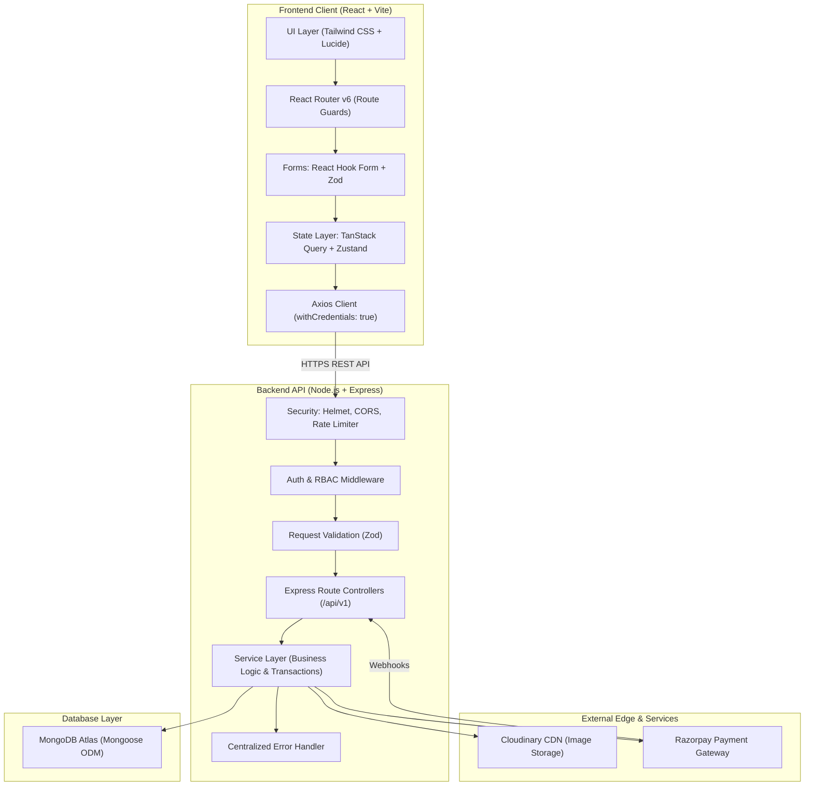

# ShopSphere — System Architecture & Technical Design

**Project Name:** ShopSphere  
**Document:** System Architecture Specification  
**Version:** 1.0.0  

---

## 1. System Topology & Architectural Overview

ShopSphere is architected as a modern, decoupled client-server web application organized within a single monorepo. The frontend single-page application (SPA) communicates with the backend REST API over HTTPS using JSON payloads and secure HTTP-only cookie-based authentication.



---

## 2. Monorepo Directory Organization

```
shopsphere/
├── client/                     # Frontend Single Page Application
│   ├── public/                 # Static assets, favicon, manifest
│   ├── src/
│   │   ├── assets/             # Brand logos, placeholder graphics
│   │   ├── components/         # Reusable UI component library
│   │   │   ├── common/         # Buttons, Badges, Modals, Spinners, Skeletons
│   │   │   ├── layout/         # Header, Footer, AnnouncementBar, Sidebar
│   │   │   ├── products/       # ProductCard, Gallery, VariantPicker, RatingStars
│   │   │   ├── cart/           # CartDrawer, CartItemRow, OrderSummary
│   │   │   └── forms/          # FormInput, Select, FormCheckbox, ErrorMessage
│   │   ├── pages/              # Route views (Home, Shop, PDP, Checkout, Admin)
│   │   ├── features/           # Domain-specific hooks and modules
│   │   │   ├── auth/           # useAuth, LoginForm, RegisterForm
│   │   │   ├── products/       # useProducts, useProductDetail, useFilters
│   │   │   ├── cart/           # useCart, useWishlist
│   │   │   └── orders/         # useOrders, useCheckout, useRazorpay
│   │   ├── hooks/              # Global custom hooks (useToast, useDebounce)
│   │   ├── lib/                # Axios instance, query client, formatting helpers
│   │   ├── services/           # API communication functions
│   │   ├── routes/             # Route definitions & ProtectedRoute guards
│   │   ├── schemas/            # Client Zod validation schemas
│   │   ├── App.jsx             # Root application component with Providers
│   │   ├── index.css           # Tailwind directives & design system CSS tokens
│   │   └── main.jsx            # DOM entry point
│   ├── package.json
│   ├── tailwind.config.js
│   ├── vite.config.js
│   └── .env.example
├── server/                     # Backend REST API Application
│   ├── src/
│   │   ├── config/             # Environment, Database, Cloudinary, Razorpay
│   │   ├── models/             # Mongoose schemas and model definitions
│   │   ├── routes/             # Express route declarations (v1)
│   │   ├── controllers/        # Request parsing and HTTP response mapping
│   │   ├── services/           # Pure business logic and database transactions
│   │   ├── middleware/         # Auth, RBAC, error, rate-limiting, logging
│   │   ├── validators/         # Zod schemas for request validation
│   │   ├── utils/              # Token helpers, API response formatters, logger
│   │   ├── jobs/               # Background cleanup (abandoned orders/stock)
│   │   ├── app.js              # Express app definition and middleware pipeline
│   │   └── server.js           # HTTP server bootstrapping and graceful shutdown
│   ├── tests/                  # API integration and unit test suite
│   ├── package.json
│   └── .env.example
├── docs/                       # Comprehensive documentation suite
│   ├── requirements.md
│   ├── architecture.md
│   ├── database-design.md
│   ├── api.md
│   ├── design-system.md
│   ├── deployment.md
│   └── testing.md
├── .gitignore
├── package.json                # Root package.json with concurrent dev scripts
└── README.md
```

---

## 3. Backend Architectural Principles

### 3.1 Strict Layered Separation of Concerns
1. **Routes Layer (`routes/`):** Purely declares URL patterns, HTTP verbs, and attaches middleware pipelines (rate limiting, auth guards, Zod validators).
2. **Controllers Layer (`controllers/`):** Unpacks HTTP request parameters (`req.body`, `req.query`, `req.params`, `req.user`), delegates processing to services, and returns standardized JSON responses. Never embeds direct database queries.
3. **Services Layer (`services/`):** Houses domain business logic, data mutation, business validation rules, transaction management, and third-party API integrations (Razorpay, Cloudinary). Completely decoupled from Express `req`/`res` objects.
4. **Data Access Layer (`models/`):** Mongoose schemas enforcing schema validation, custom query helpers, indexes, virtuals, and entity hooks.

### 3.2 Request Lifecycle & Middleware Pipeline
Every incoming HTTP request traverses the following ordered stages:
1. **Security & Protocol Headers:** `helmet()` sets standard secure headers (HSTS, Content-Security-Policy, X-Frame-Options).
2. **CORS Allowlist:** Validates `Origin` against configured client origin (`CLIENT_ORIGIN`) with `credentials: true`.
3. **Body Parsers:** `express.json({ limit: '10mb' })` and `express.urlencoded({ extended: true })`. Note: Razorpay webhook route uses raw payload capture for signature calculation.
4. **Cookie Parser:** Parses signed/unsigned cookies to extract session JWT tokens.
5. **Request Logging:** Custom structured logger records timestamp, method, endpoint, status code, and latency.
6. **Rate Limiting:** IP-based throttles preventing DDoS and brute-force attacks.
7. **Route Resolution & Validation:** Zod validator middleware checks schema conformance before reaching controller.
8. **Authentication / Authorization:** Validates JWT from cookie; injects `req.user`; blocks non-admin users on `/admin` paths.
9. **Centralized Error Handling:** All errors passed via `next(err)` are normalized into consistent JSON error contracts.

---

## 4. Frontend Architectural Principles

### 4.1 Server State vs. Client State
* **TanStack Query (React Query):** Governs all asynchronous server state (products, categories, customer profile, orders, server cart, admin metrics). Features automated caching, stale-time invalidation, background refetching, and optimistic updates.
* **Zustand:** Reserved strictly for lightweight, ephemeral UI state:
  * Cart slide-over drawer toggle (`isCartOpen`, `openCart`, `closeCart`).
  * Mobile filter drawer visibility.
  * Active search bar modal overlay.
* **React Hook Form + Zod:** Powers high-performance, uncontrolled form management with instantaneous client-side schema validation matching backend validation contracts.

### 4.2 Route Guarding Architecture
The React Router tree implements three tiers of route protection:
1. **Public Routes:** Accessible by anyone (`/`, `/shop`, `/products/:slug`, `/about`, `/login`, etc.). Redirects authenticated users away from `/login` and `/register` to `/account/profile` or previous location.
2. **Customer Protected Routes (`<ProtectedRoute />`):** Requires an active authenticated session. If unauthenticated, records current path in state and redirects to `/login`.
3. **Admin Protected Routes (`<AdminRoute />`):** Requires an authenticated session where `user.role === 'admin'`. Non-admin users are denied access and routed to a dedicated Access Denied page or storefront.

---

## 5. Security & Threat Mitigation Architecture

| Threat Vector | Mitigation Strategy |
| :--- | :--- |
| **Credential Stuffing & Brute Force** | Strict IP-based rate limiting on `/auth/login` and `/auth/register` (max 5 requests per 15 min); Argon2id/bcrypt password hashing with high work factor. |
| **Session Hijacking & XSS** | JWT auth tokens stored in `httpOnly`, `secure`, `sameSite: 'lax'` cookies; scripts running in browser cannot access token via `document.cookie`. |
| **Cross-Site Request Forgery (CSRF)** | Strict CORS origin verification matching exact client hostname, combined with `SameSite` cookies and custom header checks (`X-Requested-With`). |
| **NoSQL Query Injection** | Strict Zod payload validation rejects unexpected operators (`$gt`, `$ne`, etc.); Mongoose strict schema enforcement. |
| **Payment Tampering & Spoofing** | Order monetary totals are calculated strictly on the backend. Razorpay order IDs are cryptographically verified using HMAC SHA256 signatures before updating order status. |
| **Information Disclosure** | Centralized error handler masks internal stack traces in production (`NODE_ENV === 'production'`) returning clean operational error messages. |

---

## 6. External Service Integration Architecture

### 6.1 Razorpay Payment Flow
1. Client initiates checkout quote (`POST /api/v1/checkout/quote`).
2. Client places order (`POST /api/v1/orders`). The backend creates an internal `Order` with `paymentStatus: 'pending'`.
3. If payment method is `razorpay`, backend calls Razorpay API to generate a `razorpay_order_id` for the exact amount in integer paise.
4. Backend returns `razorpayOrderId`, `keyId`, `amount`, and `currency` to the client.
5. Client opens the Razorpay Standard Checkout SDK modal.
6. Upon payment completion, client submits `razorpay_payment_id`, `razorpay_order_id`, and `razorpay_signature` to `POST /api/v1/payments/razorpay/verify`.
7. Backend computes expected HMAC SHA256 signature using `RAZORPAY_KEY_SECRET` and compares it using timing-safe buffer comparison.
8. If valid, backend updates `Payment` record, marks `Order` as `paid` and `confirmed`, and records payment timestamp.
9. Razorpay Webhooks (`POST /api/v1/webhooks/razorpay`) provide asynchronous reconciliation in case of client network drops or browser closure.

### 6.2 Cloudinary Asset Flow
1. Admin uploads product image files via the admin product interface.
2. Image binary is routed through an authenticated backend endpoint using `multer` memory storage.
3. Backend service streams the buffer to Cloudinary using Cloudinary Node SDK with strict folder isolation (`shopsphere/products/`).
4. Cloudinary applies automated optimization (auto format `f_auto`, auto quality `q_auto`, retina sizing) and returns secure HTTPS URL and `public_id`.
5. Product document stores array of image objects: `{ url, public_id, altText, isPrimary }`.
6. Image replacement or product deletion triggers automated Cloudinary asset cleanup via `cloudinary.uploader.destroy()`.

---

## 7. Reliability, Scalability & Graceful Degradation

* **Database Connection Resilience:** Mongoose client initializes with `autoIndex: false` in production, connection pooling (`maxPoolSize: 10`), and reconnect retry logic.
* **Graceful Server Shutdown:** Listens for `SIGTERM` and `SIGINT` signals, halts acceptance of new HTTP connections, allows inflight requests to complete (with a 10-second timeout), and cleanly disconnects from MongoDB before terminating process.
* **Placeholder Asset Fallbacks:** If external CDN credentials are not provided during local development, the application transparently serves high-quality local curated placeholders without crashing.
