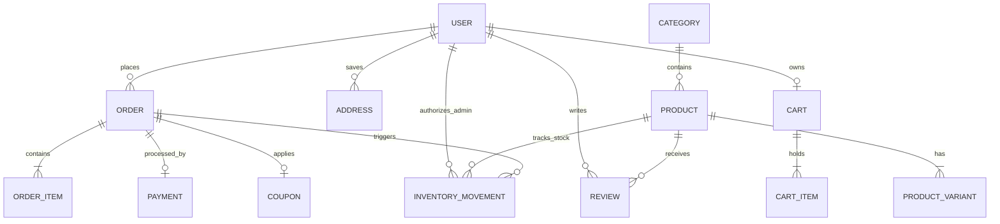
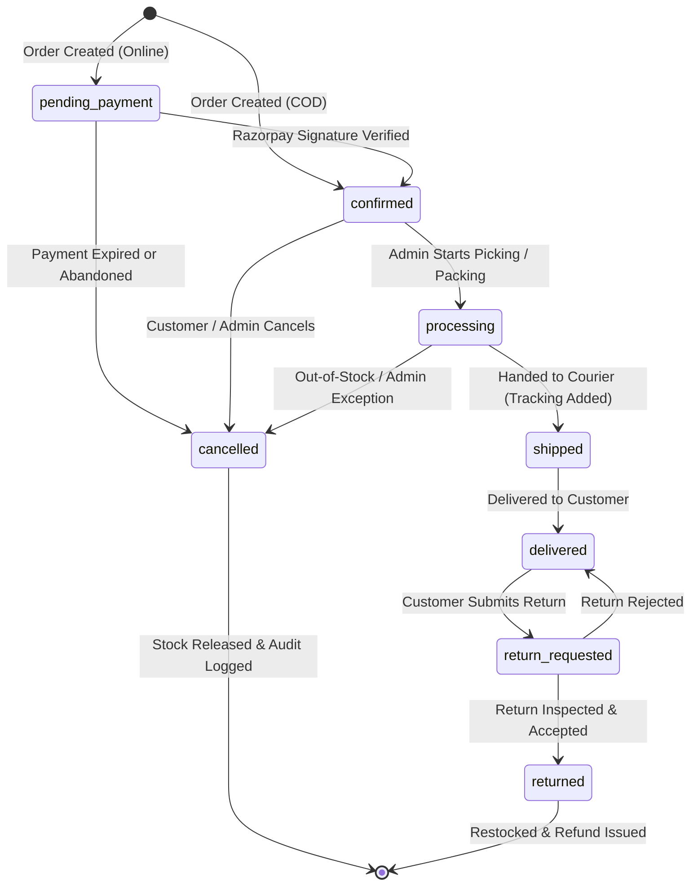

# ShopSphere — Database Design & Schema Specifications

**Project Name:** ShopSphere  
**Document:** Database Schema & Data Architecture Specification  
**Version:** 1.0.0  

---

## 1. Entity-Relationship (ER) Overview



---

## 2. Detailed Schema Definitions

### 2.1 User Entity (`users` collection)
Stores customer profiles and administrative staff credentials.

```javascript
const UserSchema = new mongoose.Schema({
  name: {
    type: String,
    required: [true, 'Name is required'],
    trim: true,
    minlength: [2, 'Name must be at least 2 characters'],
    maxlength: [80, 'Name cannot exceed 80 characters']
  },
  email: {
    type: String,
    required: [true, 'Email is required'],
    unique: true,
    lowercase: true,
    trim: true,
    index: true,
    match: [/^\S+@\S+\.\S+$/, 'Invalid email address format']
  },
  passwordHash: {
    type: String,
    required: [true, 'Password hash is required'],
    select: false // Excluded from query results by default
  },
  role: {
    type: String,
    enum: ['customer', 'admin'],
    default: 'customer',
    index: true
  },
  phone: {
    type: String,
    trim: true,
    default: ''
  },
  savedAddresses: [{
    _id: { type: mongoose.Schema.Types.ObjectId, auto: true },
    isDefault: { type: Boolean, default: false },
    fullName: { type: String, required: true },
    phone: { type: String, required: true },
    streetAddress: { type: String, required: true },
    apartment: { type: String, default: '' },
    city: { type: String, required: true },
    state: { type: String, required: true },
    postalCode: { type: String, required: true },
    country: { type: String, required: true, default: 'India' }
  }],
  wishlist: [{
    type: mongoose.Schema.Types.ObjectId,
    ref: 'Product'
  }],
  passwordResetToken: { type: String, select: false },
  passwordResetExpires: { type: Date, select: false },
  isActive: {
    type: Boolean,
    default: true,
    index: true
  }
}, {
  timestamps: true
});
```

* **Indexes & Constraints:**
  * `email`: Unique index (`{ email: 1 }, { unique: true }`).
  * `role`, `isActive`: Compound index for admin operations filtering.

---

### 2.2 Category Entity (`categories` collection)
Taxonomy for fashion classifications (e.g., "Outerwear", "Tailored Suits", "Knitwear").

```javascript
const CategorySchema = new mongoose.Schema({
  name: {
    type: String,
    required: [true, 'Category name is required'],
    trim: true,
    unique: true,
    maxlength: 60
  },
  slug: {
    type: String,
    required: [true, 'Slug is required'],
    unique: true,
    lowercase: true,
    trim: true,
    index: true
  },
  description: {
    type: String,
    default: '',
    maxlength: 500
  },
  image: {
    url: { type: String, required: true },
    public_id: { type: String, default: '' },
    altText: { type: String, default: '' }
  },
  isActive: {
    type: Boolean,
    default: true,
    index: true
  }
}, {
  timestamps: true
});
```

---

### 2.3 Product & Variant Entities (`products` collection)
Single parent document with embedded variant documents for high read efficiency.

```javascript
const VariantSchema = new mongoose.Schema({
  sku: {
    type: String,
    required: [true, 'SKU is required'],
    uppercase: true,
    trim: true
  },
  size: {
    type: String,
    required: [true, 'Size is required'],
    enum: ['XS', 'S', 'M', 'L', 'XL', 'XXL', '28', '30', '32', '34', '36', '38', 'One Size'],
    trim: true
  },
  color: {
    name: { type: String, required: true, trim: true },
    hexCode: { type: String, required: true, match: /^#([0-9a-fA-F]{3}|[0-9a-fA-F]{6})$/ }
  },
  price: {
    type: Number,
    required: [true, 'Price is required'],
    min: [0, 'Price must be positive']
  },
  compareAtPrice: {
    type: Number,
    min: [0, 'Compare price must be positive'],
    default: null
  },
  stockQuantity: {
    type: Number,
    required: [true, 'Stock quantity is required'],
    min: [0, 'Stock cannot be negative'],
    default: 0
  },
  isActive: {
    type: Boolean,
    default: true
  }
});

const ProductSchema = new mongoose.Schema({
  name: {
    type: String,
    required: [true, 'Product name is required'],
    trim: true,
    maxlength: 150
  },
  slug: {
    type: String,
    required: [true, 'Slug is required'],
    unique: true,
    lowercase: true,
    trim: true,
    index: true
  },
  description: {
    type: String,
    required: [true, 'Description is required']
  },
  categoryId: {
    type: mongoose.Schema.Types.ObjectId,
    ref: 'Category',
    required: [true, 'Category is required'],
    index: true
  },
  brand: {
    type: String,
    required: [true, 'Brand is required'],
    trim: true,
    index: true
  },
  gender: {
    type: String,
    enum: ['men', 'women', 'unisex'],
    required: true,
    index: true
  },
  tags: [{
    type: String,
    lowercase: true,
    trim: true
  }],
  images: [{
    url: { type: String, required: true },
    public_id: { type: String, default: '' },
    altText: { type: String, default: '' },
    isPrimary: { type: Boolean, default: false }
  }],
  variants: [VariantSchema],
  isFeatured: {
    type: Boolean,
    default: false,
    index: true
  },
  isActive: {
    type: Boolean,
    default: true,
    index: true
  },
  totalSalesCount: {
    type: Number,
    default: 0,
    index: true
  },
  averageRating: {
    type: Number,
    default: 0,
    min: 0,
    max: 5
  },
  reviewCount: {
    type: Number,
    default: 0
  }
}, {
  timestamps: true
});
```

* **Indexes & Constraints:**
  * `slug`: Unique index (`{ slug: 1 }, { unique: true }`).
  * `variants.sku`: Sparse unique index (`{ "variants.sku": 1 }, { unique: true }`).
  * Text search index: `{ name: "text", brand: "text", tags: "text", description: "text" }`.
  * Compound index for faceted catalog filtering: `{ categoryId: 1, gender: 1, isActive: 1 }`.
  * Compound index for price sorting: `{ "variants.price": 1, isActive: 1 }`.

---

### 2.4 Cart Entity (`carts` collection)
Persistent shopping bag linked to a user.

```javascript
const CartItemSchema = new mongoose.Schema({
  productId: {
    type: mongoose.Schema.Types.ObjectId,
    ref: 'Product',
    required: true
  },
  variantSku: {
    type: String,
    required: true,
    uppercase: true
  },
  quantity: {
    type: Number,
    required: true,
    min: [1, 'Quantity must be at least 1'],
    default: 1
  }
}, { _id: false });

const CartSchema = new mongoose.Schema({
  userId: {
    type: mongoose.Schema.Types.ObjectId,
    ref: 'User',
    required: true,
    unique: true,
    index: true
  },
  items: [CartItemSchema]
}, {
  timestamps: true
});
```

---

### 2.5 Order Entity (`orders` collection)
Immutable historical record capturing exact item and address snapshots.

```javascript
const OrderItemSnapshotSchema = new mongoose.Schema({
  productId: {
    type: mongoose.Schema.Types.ObjectId,
    ref: 'Product',
    required: true
  },
  variantSku: {
    type: String,
    required: true
  },
  name: { type: String, required: true },
  size: { type: String, required: true },
  color: {
    name: { type: String, required: true },
    hexCode: { type: String, required: true }
  },
  image: { type: String, required: true },
  unitPrice: { type: Number, required: true },
  quantity: { type: Number, required: true, min: 1 },
  lineTotal: { type: Number, required: true }
}, { _id: false });

const OrderSchema = new mongoose.Schema({
  orderNumber: {
    type: String,
    required: true,
    unique: true,
    uppercase: true,
    index: true
  },
  userId: {
    type: mongoose.Schema.Types.ObjectId,
    ref: 'User',
    required: true,
    index: true
  },
  items: [OrderItemSnapshotSchema],
  shippingAddressSnapshot: {
    fullName: { type: String, required: true },
    phone: { type: String, required: true },
    streetAddress: { type: String, required: true },
    apartment: { type: String, default: '' },
    city: { type: String, required: true },
    state: { type: String, required: true },
    postalCode: { type: String, required: true },
    country: { type: String, required: true }
  },
  subtotal: { type: Number, required: true },
  discount: { type: Number, default: 0 },
  shippingFee: { type: Number, default: 0 },
  tax: { type: Number, default: 0 },
  total: { type: Number, required: true },
  couponCode: { type: String, default: null },
  couponId: {
    type: mongoose.Schema.Types.ObjectId,
    ref: 'Coupon',
    default: null
  },
  paymentMethod: {
    type: String,
    enum: ['razorpay', 'cod'],
    required: true
  },
  paymentStatus: {
    type: String,
    enum: ['pending', 'authorized', 'paid', 'failed', 'refund_pending', 'refunded'],
    default: 'pending',
    index: true
  },
  orderStatus: {
    type: String,
    enum: ['pending_payment', 'confirmed', 'processing', 'shipped', 'delivered', 'cancelled', 'return_requested', 'returned'],
    default: 'pending_payment',
    index: true
  },
  statusTimeline: [{
    status: { type: String, required: true },
    timestamp: { type: Date, default: Date.now },
    note: { type: String, default: '' },
    updatedBy: { type: mongoose.Schema.Types.ObjectId, ref: 'User' }
  }],
  trackingNumber: { type: String, default: '' },
  carrierName: { type: String, default: '' },
  cancellationReason: { type: String, default: '' },
  cancelledAt: { type: Date }
}, {
  timestamps: true
});
```

* **Indexes:**
  * `{ orderNumber: 1 }, { unique: true }`
  * `{ userId: 1, createdAt: -1 }` (for customer order history)
  * `{ orderStatus: 1, paymentStatus: 1, createdAt: -1 }` (for admin fulfillment queue)

---

### 2.6 Payment Entity (`payments` collection)
Cryptographic record of Razorpay transactions and webhook events.

```javascript
const PaymentSchema = new mongoose.Schema({
  orderId: {
    type: mongoose.Schema.Types.ObjectId,
    ref: 'Order',
    required: true,
    index: true
  },
  razorpayOrderId: {
    type: String,
    required: true,
    index: true
  },
  razorpayPaymentId: {
    type: String,
    default: null,
    index: true
  },
  razorpaySignature: {
    type: String,
    default: null
  },
  amount: {
    type: Number,
    required: true
  },
  currency: {
    type: String,
    required: true,
    default: 'INR'
  },
  paymentStatus: {
    type: String,
    enum: ['pending', 'authorized', 'paid', 'failed', 'refunded'],
    default: 'pending',
    index: true
  },
  verifiedAt: {
    type: Date,
    default: null
  },
  failureReason: {
    type: String,
    default: null
  },
  refundInfo: {
    refundId: { type: String },
    amount: { type: Number },
    reason: { type: String },
    refundedAt: { type: Date }
  }
}, {
  timestamps: true
});
```

---

### 2.7 Review Entity (`reviews` collection)
Product reviews restricted to verified purchasers with moderation status and automated rating aggregation.

```javascript
const ReviewSchema = new mongoose.Schema({
  productId: {
    type: mongoose.Schema.Types.ObjectId,
    ref: 'Product',
    required: true,
    index: true
  },
  userId: {
    type: mongoose.Schema.Types.ObjectId,
    ref: 'User',
    required: true,
    index: true
  },
  orderId: {
    type: mongoose.Schema.Types.ObjectId,
    ref: 'Order',
    required: true
  },
  rating: {
    type: Number,
    required: [true, 'Rating is required'],
    min: [1, 'Rating must be at least 1 star'],
    max: [5, 'Rating cannot exceed 5 stars']
  },
  title: {
    type: String,
    required: [true, 'Review title is required'],
    trim: true,
    maxlength: [100, 'Review title cannot exceed 100 characters']
  },
  comment: {
    type: String,
    required: [true, 'Review comment is required'],
    trim: true,
    maxlength: [1000, 'Review comment cannot exceed 1000 characters']
  },
  isVerifiedPurchase: {
    type: Boolean,
    default: true
  },
  status: {
    type: String,
    enum: ['pending', 'approved', 'rejected'],
    default: 'approved',
    index: true
  },
  isFeatured: {
    type: Boolean,
    default: false
  }
}, {
  timestamps: true
});

// Indexes & Constraints:
// 1. Exactly one review per product per customer
ReviewSchema.index({ productId: 1, userId: 1 }, { unique: true });

// 2. Optimized compound index for storefront product detail pages
ReviewSchema.index({ productId: 1, status: 1, createdAt: -1 });

// 3. Admin moderation queue compound index
ReviewSchema.index({ status: 1, rating: 1, createdAt: -1 });

// Static Aggregation Hook for Product Average Rating Recalculation
ReviewSchema.statics.calculateAverageRating = async function(productId) {
  const stats = await this.aggregate([
    { $match: { productId: new mongoose.Types.ObjectId(productId), status: 'approved' } },
    {
      $group: {
        _id: '$productId',
        reviewCount: { $sum: 1 },
        averageRating: { $avg: '$rating' }
      }
    }
  ]);

  if (stats.length > 0) {
    await mongoose.model('Product').findByIdAndUpdate(productId, {
      averageRating: Math.round(stats[0].averageRating * 10) / 10,
      reviewCount: stats[0].reviewCount
    });
  } else {
    await mongoose.model('Product').findByIdAndUpdate(productId, {
      averageRating: 0,
      reviewCount: 0
    });
  }
};

ReviewSchema.post('save', function() {
  this.constructor.calculateAverageRating(this.productId);
});

ReviewSchema.post('findOneAndDelete', function(doc) {
  if (doc) {
    doc.constructor.calculateAverageRating(doc.productId);
  }
});
```

---

### 2.8 Coupon Entity (`coupons` collection)
Discount rules, caps, and redemption counters.

```javascript
const CouponSchema = new mongoose.Schema({
  code: {
    type: String,
    required: true,
    unique: true,
    uppercase: true,
    trim: true,
    index: true
  },
  discountType: {
    type: String,
    enum: ['percentage', 'fixed'],
    required: true
  },
  discountValue: {
    type: Number,
    required: true,
    min: [1, 'Discount value must be at least 1']
  },
  minOrderAmount: {
    type: Number,
    default: 0
  },
  maxDiscountAmount: {
    type: Number,
    default: null // Only applies to percentage discounts
  },
  startDate: {
    type: Date,
    default: Date.now
  },
  expiryDate: {
    type: Date,
    required: true
  },
  usageLimit: {
    type: Number,
    default: 100 // Total times coupon can be redeemed
  },
  usedCount: {
    type: Number,
    default: 0
  },
  perUserLimit: {
    type: Number,
    default: 1
  },
  isActive: {
    type: Boolean,
    default: true,
    index: true
  }
}, {
  timestamps: true
});
```

---

### 2.9 InventoryMovement Entity (`inventory_movements` collection)
Immutable audit ledger for every stock delta.

```javascript
const InventoryMovementSchema = new mongoose.Schema({
  productId: {
    type: mongoose.Schema.Types.ObjectId,
    ref: 'Product',
    required: true,
    index: true
  },
  variantSku: {
    type: String,
    required: true,
    index: true
  },
  quantityChange: {
    type: Number,
    required: true // e.g. -2 for purchase, +10 for restock
  },
  previousStock: {
    type: Number,
    required: true
  },
  newStock: {
    type: Number,
    required: true
  },
  reason: {
    type: String,
    enum: [
      'initial_creation',
      'restock',
      'order_placed',
      'order_cancelled',
      'return_restock',
      'manual_adjustment',
      'damaged_writeoff'
    ],
    required: true
  },
  orderId: {
    type: mongoose.Schema.Types.ObjectId,
    ref: 'Order',
    default: null
  },
  adminId: {
    type: mongoose.Schema.Types.ObjectId,
    ref: 'User',
    default: null
  },
  note: {
    type: String,
    default: ''
  }
}, {
  timestamps: { createdAt: true, updatedAt: false }
});
```

---

## 3. Order & Payment State Machine Transitions



### 3.1 Transition Rules & Side Effects
1. **`pending_payment -> confirmed`**:
   * Trigger: Payment signature verified or webhook `payment.captured` received.
   * Side effect: Payment marked `paid`; email order confirmation dispatched.
2. **`confirmed / processing -> cancelled`**:
   * Permitted actors: Customer (only if `confirmed`); Admin (anytime before `shipped`).
   * Side effect: Atomically restores variant stock quantities; creates `InventoryMovement` with reason `order_cancelled`; triggers refund if already paid.
3. **`delivered -> return_requested`**:
   * Permitted actors: Customer within 14 days of delivery timestamp.
4. **`return_requested -> returned`**:
   * Permitted actors: Admin after warehouse physical inspection.
   * Side effect: Restores variant stock; initiates payment refund.
