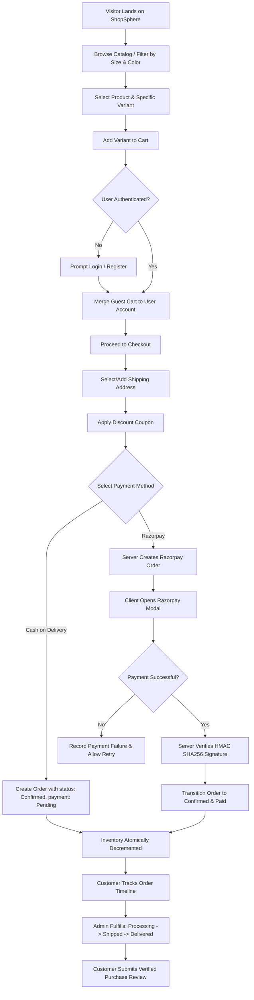

# ShopSphere — Project Requirements & Specifications

**Project Name:** ShopSphere  
**Version:** 1.0.0 (Phase 1 Specifications)  
**System Type:** Full-Stack Fashion E-Commerce Web Application (Single-Store Retail)  
**Target Audience:** Modern fashion retail consumers and boutique store operations staff.

---

## 1. Executive Summary & Objective

ShopSphere is an advanced, production-oriented fashion e-commerce web application. The platform provides a curated editorial shopping experience for apparel, footwear, and accessories across Men's, Women's, and Unisex collections. Built with a minimal, warm ivory aesthetic and high-performance full-stack architecture, ShopSphere bridges customer-delighting retail touchpoints with robust back-office inventory control, order fulfillment, and financial integrity.

### 1.1 Scope Boundaries
* **In Scope:**
  * Single-store retail architecture with multi-role access control (`customer`, `admin`).
  * Catalog browsing, multi-attribute filtering (category, size, color, price range, tags, gender), and real-time search.
  * Fashion-specific variant matrix (SKU, size, color swatch, price, compare-at price, inventory stock).
  * Persistent shopping cart and customer wishlist.
  * Multi-step checkout with server-calculated shipping, taxes, and coupon discounts.
  * Dual payment gateways: Cash on Delivery (COD) and Razorpay (server-initiated orders and cryptographic HMAC SHA256 signature verification).
  * Post-purchase order tracking with real-time status timeline.
  * Verified purchase customer review system.
  * Self-service cancellation and return request workflows under policy guidelines.
  * Administrative dashboard for catalog authoring, variant inventory movements, order fulfillment, customer records, coupon campaign management, and revenue analytics.
* **Out of Scope (v1):**
  * Multi-vendor / marketplace seller payouts.
  * Physical POS hardware synchronization.
  * Mobile native binary applications (the web application is fully responsive for all mobile viewports).

---

## 2. User Roles & Permissions

The system enforces strict role-based access control (RBAC):

| Role | Description | Access Rights |
| :--- | :--- | :--- |
| **Guest Customer** | Unauthenticated site visitor | Browse catalog, search, filter, view product details, select variants, manage local/session cart and wishlist, initiate registration/login. |
| **Registered Customer** | Authenticated retail customer | Manage profile, multi-address book, persistent server cart and wishlist, apply coupons, execute checkout, pay via Razorpay or COD, view order history and timeline, request cancellations/returns, write verified reviews. |
| **Administrator** | Authenticated store manager / operations staff | Full access to `/admin` routes and administrative APIs: CRUD products and variants, manage categories, adjust stock with audit reasons, view/update orders, manage coupons, review customers, inspect sales analytics. |

---

## 3. Detailed Acceptance Criteria

### 3.1 Authentication & Security Acceptance Criteria
* **AC-AUTH-01:** Customer registration requires `name`, valid normalized `email`, `password` (minimum 8 characters, requiring mixed character complexity), and optional `phone`.
* **AC-AUTH-02:** Passwords must be hashed using Argon2id or bcrypt (salt rounds $\ge 12$). Plaintext passwords must never be logged or persisted.
* **AC-AUTH-03:** Authentication sessions are governed by secure HTTP-only cookies storing signed JSON Web Tokens (JWT) with `SameSite=Lax` (or `None` for cross-site with `Secure=true`) and `Secure=true` in production.
* **AC-AUTH-04:** Rate limiting must enforce strict thresholds on authentication routes (e.g., maximum 5 failed attempts per 15-minute window per IP) to mitigate brute-force attacks.
* **AC-AUTH-05:** Password reset requests generate a cryptographically random token with an expiry window of 60 minutes, delivered via verified token hash comparison.
* **AC-AUTH-06:** Protected API endpoints reject unauthorized requests with HTTP `401 Unauthorized` and administrative endpoints reject non-admin users with HTTP `403 Forbidden`.

### 3.2 Product Catalog & Variant Matrix Acceptance Criteria
* **AC-CAT-01:** Products must feature a unique URL slug, name, description, brand, category reference, tags, gender classification (`men`, `women`, `unisex`), active status flag, and an array of high-resolution images.
* **AC-CAT-02:** Every purchasable variation must possess a unique SKU, size designation (e.g., XS, S, M, L, XL, XXL or numerical sizing), color name, hex code, price, optional comparison-at price, and individual stock count.
* **AC-CAT-03:** Catalog search queries evaluate matches against product names, brands, descriptions, and tags with case-insensitive tokenization.
* **AC-CAT-04:** Faceted filtering supports multiple criteria simultaneously: Category, Gender, Size, Color, Price Min/Max, and In-Stock Only.
* **AC-CAT-05:** Catalog sorting supports `newest`, `price_asc`, `price_desc`, and `popularity` (derived from real order volume).
* **AC-CAT-06:** Out-of-stock variants must display disabled size/color selectors and prevent cart addition.

### 3.3 Shopping Cart & Wishlist Acceptance Criteria
* **AC-CART-01:** Adding an item requires a specific variant SKU. Adding the same SKU multiple times increments the quantity up to the variant's available inventory ceiling.
* **AC-CART-02:** Cart calculations (subtotal, shipping, taxes, discounts) are computed server-side on every fetch or mutation. Client-sent monetary values are strictly ignored.
* **AC-CART-03:** When a user logs in, items in their guest session cart are automatically merged into their persistent server cart.
* **AC-CART-04:** Customers can save products to their wishlist with single-click toggle actions; wishlist items can be directly converted into cart items upon variant selection.

### 3.4 Checkout & Coupon Engine Acceptance Criteria
* **AC-CHK-01:** Checkout requires selecting or entering a full shipping address: full name, street address, apartment/suite, city, state/province, postal/ZIP code, country, and contact phone.
* **AC-CHK-02:** Coupon validation validates: active status, start/end dates, minimum order subtotal requirement, usage limit per coupon, and usage limit per customer.
* **AC-CHK-03:** Coupons support percentage discounts (with optional maximum cap) and fixed amount discounts.
* **AC-CHK-04:** The checkout quote endpoint returns an authoritative breakdown: `subtotal`, `couponDiscount`, `shippingFee` (e.g., free above ₹1999 / $100 threshold), `tax`, and `grandTotal`.

### 3.5 Payments (Razorpay & COD) Acceptance Criteria
* **AC-PAY-01:** Razorpay payment orders are created strictly by the backend server using the server-calculated grand total in the configured integer subunit currency (e.g., paise for INR).
* **AC-PAY-02:** Frontend initiates checkout with Razorpay SDK passing only the `razorpayOrderId`, `amount`, `currency`, and public `key_id`.
* **AC-PAY-03:** The backend payment verification endpoint validates the cryptographic HMAC SHA256 signature generated over `${razorpay_order_id}|${razorpay_payment_id}` using `RAZORPAY_KEY_SECRET`.
* **AC-PAY-04:** Webhooks from Razorpay are verified against raw request payload using `RAZORPAY_WEBHOOK_SECRET` with idempotent event handling.
* **AC-PAY-05:** Orders are never transitioned to `paid` status without backend cryptographic signature or webhook verification.
* **AC-PAY-06:** Cash on Delivery (COD) orders transition directly to `confirmed` with payment status `pending`.

### 3.6 Inventory Integrity & Order Management Acceptance Criteria
* **AC-ORD-01:** Order placement atomically decrements inventory stock for the exact variant SKUs purchased using database transactions or conditional atomic operators (`$inc` with `$gte` stock checks).
* **AC-ORD-02:** Order cancellations restore inventory for all line-item variant SKUs and generate corresponding `InventoryMovement` records.
* **AC-ORD-03:** Every order is assigned a human-readable, unique order number (e.g., `ORD-202610-84920`).
* **AC-ORD-04:** Line items store an immutable snapshot of product name, variant SKU, selected size, color, image URL, and purchase unit price at the time of checkout.

### 3.7 Administration & Analytics Acceptance Criteria
* **AC-ADM-01:** Admins can create and edit products with full multi-variant matrix controls and image asset management.
* **AC-ADM-02:** Admins can execute manual inventory adjustments specifying a reason (`restock`, `damaged`, `audit_correction`) with automatic audit log creation.
* **AC-ADM-03:** Order status updates follow a strict finite state machine: `pending_payment` -> `confirmed` -> `processing` -> `shipped` -> `delivered` / `cancelled` / `returned`.
* **AC-ADM-04:** Sales analytics compute real metrics directly from database aggregations: Total Gross Orders, Net Paid Revenue, Refund Totals, Average Order Value (AOV), and Low-Stock Variant Alerts ($\le 5$ units).

---

## 4. Page & Feature Inventory

### 4.1 Public & Customer Storefront Pages

| Route | Page Title | Primary Features & Components |
| :--- | :--- | :--- |
| `/` | Home / Editorial Showcase | Hero video/banner, Curated Collections (Men/Women/Unisex), Featured Arrivals, Best Sellers, Editorial Story banner, Trust markers, Newsletter signup. |
| `/shop` | All Collections & Catalog | Full catalog view, multi-attribute filter drawer/sidebar, sorting dropdown, active filter chips, responsive product grid, pagination controls. |
| `/category/:slug` | Category Catalog | Dynamic category header, contextual description, filtered product grid for the category, nested sub-filters. |
| `/products/:slug` | Product Detail (PDP) | Multi-image gallery with zoom/thumbnails, variant selectors (size/color), stock level indicator, dynamic price display, size guide modal, Add to Cart, Add to Wishlist, verified reviews accordion, related items carousel. |
| `/search` | Search Results | Instant search input, highlighted query tags, matched items grid, empty-state suggestions. |
| `/cart` | Shopping Bag | Detailed line items list, variant breakdown, quantity stepper, price breakdown, coupon code input with instant validation, free shipping progress bar, proceed to checkout button. |
| `/wishlist` | Saved Favorites | Grid of saved items with quick-add to bag modal, removal button, empty state CTA. |
| `/login` | Customer Sign In | Email and password input, remember me toggle, forgot password link, redirection handling, link to registration. |
| `/register` | Create Account | Name, email, password strength meter, password confirmation, terms acceptance checkbox. |
| `/forgot-password` | Password Recovery | Email input, reset link trigger, confirmation screen. |
| `/reset-password` | Set New Password | Token validation, new password input, confirmation, redirection to login. |
| `/about` | Brand Story | Brand values, craftsmanship, sustainable fashion commitments, high-fashion editorial imagery. |
| `/contact` | Customer Concierge | Contact form (name, email, subject, message), FAQ links, customer service hours. |
| `/privacy` | Privacy Policy | Detailed privacy practices, cookie disclosures, data rights under privacy standards. |
| `/terms` | Terms of Service | Commercial terms, acceptable use, intellectual property, governing law. |
| `/shipping-policy` | Shipping & Delivery | Shipping tiers, turnaround times, domestic and international shipping rates. |
| `/returns-policy` | Returns & Exchanges | 14-day return window conditions, non-returnable items, step-by-step return instructions. |

### 4.2 Customer Account Pages (Protected)

| Route | Page Title | Primary Features & Components |
| :--- | :--- | :--- |
| `/account/profile` | Personal Information | Edit name, email, phone number, change password form, account status summary. |
| `/account/addresses` | Address Book | Saved shipping addresses grid, set default address toggle, add new address modal, edit/delete actions. |
| `/account/orders` | Order History | Paginated list of past orders with status badges, date, items preview, order totals, and direct detail links. |
| `/account/orders/:id` | Order Details & Tracking | Comprehensive order summary, shipping address, line items with variant details, interactive status timeline, cancel order action (if eligible), return request action (if delivered), download invoice button. |

### 4.3 Checkout & Payment Pages

| Route | Page Title | Primary Features & Components |
| :--- | :--- | :--- |
| `/checkout` | Seamless Checkout | Multi-step/accordion checkout: Shipping Address selection/creation, Shipping Method, Payment Method selection (Razorpay Online vs. Cash on Delivery), Order Summary sidebar with coupon drawer. |
| `/payment/result` | Payment & Order Confirmation | Success/Failure status display, generated Order Number, transaction reference ID, delivery estimate, continue shopping CTA. |

### 4.4 Administrator Pages (Protected - Admin Only)

| Route | Page Title | Primary Features & Components |
| :--- | :--- | :--- |
| `/admin` | Admin Dashboard Overview | KPI stat cards (Total Revenue, Paid Orders, Pending Shipments, Low Stock Variants), Net Sales chart, Order status breakdown, Recent orders table. |
| `/admin/products` | Catalog Management | Searchable, paginated product data table, filter by category/status, quick stock view, action menu (edit, archive, delete). |
| `/admin/products/new` | Product Creator | Multi-section form: General info, category selector, image uploader (Cloudinary), variant matrix generator (size x color generator, SKU auto-tagger, pricing, stock input). |
| `/admin/products/:id/edit`| Product Editor | Edit existing product details, manage existing variant matrix, add/remove images, toggle active status. |
| `/admin/categories` | Categories Manager | Category listing table, create category modal (name, slug, image, description), edit/delete categories. |
| `/admin/orders` | Order Fulfillment Center | Filter orders by status (`pending_payment`, `confirmed`, `processing`, `shipped`, `delivered`, `cancelled`), customer search, date range filter, order inspect drawer. |
| `/admin/orders/:id` | Order Detail & Action Center| Detailed item list, customer contact, payment verification snapshot, manual status transition dropdown with confirmation dialog, shipment tracking number input. |
| `/admin/inventory` | Inventory & Stock Control | Stock levels table by SKU, visual low-stock badges, quick stock adjustment modal with audit reason dropdown, stock movement history ledger. |
| `/admin/customers` | Customer Directory | Searchable list of registered customers, total orders placed, lifetime value, registered date, active status switch. |
| `/admin/coupons` | Promotion & Coupon Engine | Coupon listing with usage counts, create coupon modal (code, percentage/fixed, min spend, max discount, expiry, total quota), toggle active state. |
| `/admin/analytics` | Sales & Business Intelligence| Date-range filterable revenue charts, order conversion metrics, Top 10 selling products table, category revenue distribution. |

---

## 5. End-to-End User Workflows

---

## 6. Business Policies & Edge Cases

* **Order Cancellation Policy:** Customers may cancel orders independently while the order state is `pending_payment` or `confirmed`. Once transitioned to `processing` or `shipped`, customer cancellation is locked and must be handled via customer support.
* **Return Policy:** Customers may submit a return request within 14 days after the order is marked `delivered`.
* **Stock Exhaustion During Checkout:** If a variant's stock reaches 0 between cart addition and final payment submission, the transaction rejects with an explicit `INSUFFICIENT_STOCK` error code, prompting the user to adjust their cart.
* **Price Tampering Prevention:** All prices, discounts, taxes, and shipping rates are strictly fetched and calculated on the server from the product database. No client-supplied financial amount is honored.
